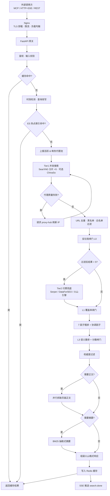
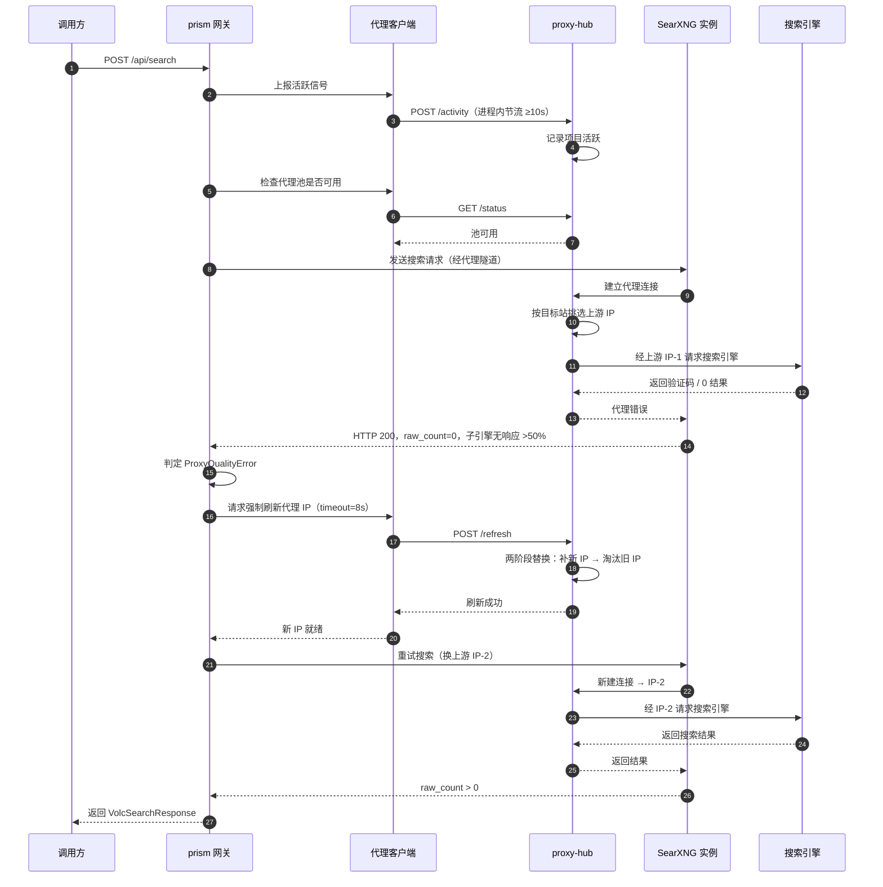
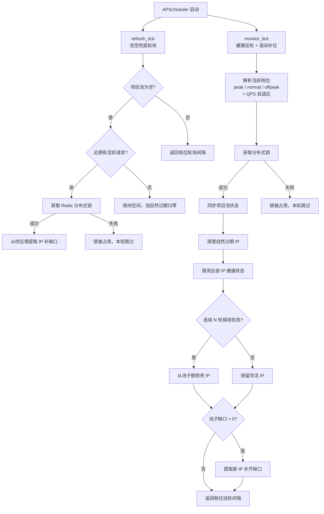

# LLM 联网搜索 MCP Server · 最终技术方案

> **版本**：v2.9 · 2026-09-02
> **定位**：独立通用基础设施，对外暴露 MCP + REST，不绑定任何业务方
> **对标**：火山引擎 AI 搜索（`volcengine.com/docs/85296/1544954`）
> **基础**：本文档在 `llm-search-mcp-server-design.md`（v1）基础上，整合"对比诊断 / 可行性审视 / 多租户 · 校验 · 成本分档 · 落地细节"四大领域补强而成。v1 保留原位供对照。

---

## 目录

0. 变更日志（相对 v1）
1. 需求与目标
2. 总体架构
   - 2.1–2.5 端到端请求流程与代理链路（以当前代码为准）
3. Tier 引擎选型
4. 6 层数据治理（含国内广告专项）
5. 纯服务端行为反馈 + 域名信誉
6. 七因子排序公式
7. 多租户鉴权 / 校验 / 配额
8. 部署架构（S / M / L 三档）
9. 法律 / 合规 / 安全
10. 可观测性与运维
11. 验证与测试
12. 附录
13. 实现状态与未实现功能清单

---

## 0. 变更日志（相对 v1）

相对 `llm-search-mcp-server-design.md`：

**保留（整体采纳）**：
- 6 层数据治理体系（§6）
- 国内广告混杂专项（§6.7）
- 纯服务端 Session 行为反馈（§7）
- 动态黑名单 + 信誉衰减
- 微信公众号法律风险应对（§13.1）
- 代理预算熔断（§13.2）
- 治理延迟分级 Fast / Standard / Deep（§13.3）
- Playwright Stealth 栈

**新增**：
- API Key 鉴权 + 多租户配额（Auth Layer）
- Input / Output Validator 系统化层
- URL 活性探测（`reachable` 标）
- `/health` + `/ready` 探针分离
- Prometheus 具体指标清单（12 个）
- S / M / L 三档预算（每项单价明示）
- MCP `session_id` 解析规则（STDIO / SSE / REST 各自实现）
- `published_at` fallback 链（6 级）
- BM25 的 ad-hoc corpus 定义
- 种子数据采购清单（T1/denylist/ICP/域名年龄/AIGC 模板）
- SSRF 防护 / API Key 哈希存储 / PII 最小化
- 《个保法》合规（90 天偏好留存 + DELETE 接口）
- SSE 断线重连（Last-Event-ID + Redis event buffer）——仅事件带自增 id 落地，断线重连未实现
- JSON-RPC 错误码标准化
- `trace_id / query_id` 贯穿
- 引擎健康探针 + 熔断摘除（探针每 5 分钟仅告警，摘除由熔断器负责：9s 内失败 3 次跳过该引擎）
- 精度评估集构造流程（100 条月度回归）
- 混沌测试清单

**调整**：
- Tier 2 付费 API：`Brave + Tavily` → `DataForSEO + Serper`（单次成本降 1-2 个数量级）
- 延迟目标放宽：Standard `300ms → 500ms`、Deep `800ms → 2s`（基于 CPU 推理实测）
- 成本目标重设：从 `¥0.0005-0.002/次` → `¥0.003-0.005/次`（加入代理、备案、推理资源后的务实线）
- **Tier 3 内容提取栈**：`trafilatura + Readability + 裸 Playwright` → **Crawl4AI**（原生 LLM-friendly Markdown 输出，内置 JS 渲染、反爬、robots.txt；token 消耗降 80%+）

**实现补充（v2.1）**：
- `trace_id` 中间件落地：每个 HTTP 请求生成 12 位 hex trace_id，经 `ContextVar` 自动注入所有日志行，响应头回传 `X-Trace-Id`
- 时效查询自动调参：**两阶段检测**——正则 fast-path（`validator.detect_temporal_query`，"今天/最新/这两天…"）+ 向量 fallback（`embedder.is_temporal_semantic`，cos≥0.65，覆盖"前阵子"等口语）。命中后只提升 `intent=news`（recency 排序加成），**不再注入硬时间过滤**——旧版强制 `TimeRange=OneDay` 会把常青/医学类查询召回腰斩；硬时间窗仅在调用方显式传 `TimeRange` 时才下发。另：`rewriter.strip_temporal_markers` 剥离引擎 query 中的独立时效副词，避免其盖过日期戳招来的农场页
- `require_detail` 真正落地：`app/services/fetcher.py`（trafilatura → readability-lxml → Crawl4AI 三级降级）+ `/api/fetch` 独立端点，结果附带 `page_content` Markdown 字段

**实现补充（v2.2）**：
- **7因子异步排序**（`app/services/ranker.py`）：recency(0.30) + source_trust(0.20) + BM25(0.20) + domain_reputation(0.15) + session_boost(0.10) + commercial_penalty(0.05)；域名信誉与 session boost 通过 Redis pipeline 批量读取，零额外延迟
- **Session 行为信号**（`app/services/session_signals.py`）：rescue / rephrase / drill_down / silent_accept 信号写入 Redis LIST，自动同步域名信誉 HASH
- **`published_at` 6级 fallback**（`app/services/date_extractor.py`）：engine值 → extra dict(OG/JSON-LD) → URL路径正则 → 文本相对时间 → None
- **`commercial_score` 规则层**（`app/services/commercial.py`）：域名黑名单 + URL路径 + 标题关键词 + CTA短语，结果附 `tags: ["推广"/"商业内容"]`
- **APScheduler 定时任务**（`app/services/scheduler.py`）：信誉月度衰减（×0.9）+ 引擎健康探针（每5分钟）
- **并发优化**：Tier 1 引擎改为 `asyncio.as_completed` 真并发推送，熔断器检查 pipeline 合并为单次 Redis 往返；SearXNG 持久化 httpx 连接池 + HTTP/1.1 短连接（`Connection: close` + `enable_http2: false`，避免代理隧道上 HTTP/2 多路复用被中间盒干扰）；DDGS 独立线程池+6s 超时
- **合规接口（个保法偏好删除）**：`DELETE /admin/preferences/{user_id}` 仅完成设计，**代码中尚未实现**（`app/api/admin.py` 无此端点）；HMAC-SHA256 哈希函数已就绪（`app/core/auth.py` `hmac_hash`），补端点即可接通

**实现补充（v2.5）**：
- **BM25 抽取式摘要全面替换 DeepSeek**（`app/services/extractive.py` + `app/services/summarizer.py`）：彻底移除 LLM 调用，整体摘要（`Result.SummarizedAnswer`）与每条结果摘要（`WebResults[i].Summary`）均改为 BM25 关键句抽取；混合分词器（CJK 字级 + ASCII 词级），典型延迟 <100ms，无网络依赖，无 Token 成本
- **per-result Summary 语义化**（`app/api/compat.py`）：`_build_summary()` 从 `page_content` 中用 BM25 选取最相关 3 句，而非截断。`page_content` 为空时降级为 `snippet`
- **NeedSummary 无条件可用**：BM25 不依赖任何 API Key，`is_configured()` 恒返回 True，`NeedSummary=true` 始终生效
- **缓存键完整化**（`app/services/cache.py`）：`_cache_key()` 扩展至 13 个字段（新增 `need_content/need_summary/need_url/content_formats/sites/block_hosts/auth_level/sort_by/intent`），防止不同请求 shape 命中同一缓存；缓存值结构升级为 `{"results": [...], "summary": ""}` 并向后兼容
- **预算底线保护**（`app/core/config.py`）：新增 `content_fetch_budget_s=5.0`（NeedContent 抓页面最小时间底线）和 `summary_budget_s=1.0`（NeedSummary 安全网），解决 SearXNG 耗时后剩余预算不足导致内容全部超时的问题
- **summary_task asyncio.wait_for 包裹**：避免 summary 任务无限阻塞
- **QueryRewrite / NeedSummary / NeedUrl / ContentFormats / intent / high_quality 同步至 search_stream**（`app/services/orchestrator.py`）：SSE 流式接口与 REST 接口功能完全对齐
- **SearXNG 引擎调优**（`searxng/settings.template.yml`，v2.9 起三实例共用一份模板）：bing 引擎切换为 `cn.bing.com`，代理超时 5.0s/max 6.0s；当前活跃引擎：baidu + bing + sogou + quark + sogou wechat（公众号源，360search/bilibili 已移除：前者对机房/代理 IP 反爬激进常返回空 body，后者视频内容对网页查询是噪音）；chinaso 已以**独立引擎**回归（`app/engines/chinaso.py`，`chinaso_enabled` 开关，须走代理隧道）
- **SearXNG 并发多页翻页**（`app/engines/searxng.py`）：根据 `num` 和引擎数动态计算所需页数（最多 3 页），所有页面通过 `asyncio.gather` 一次性并发发出，总耗时 ≈ max(各页延迟) 而非累加；bilibili 的 `content` 字段为空（无简介），如需简介可开启 `NeedContent=true`
- **代理策略确认**：代理池已拆分为独立 **proxy-hub** 服务（qg.net 短效住宅 IP，隧道地址 + 项目账密），prism 侧只配 `PROXY_TUNNEL_URL` 一个隧道出口，不再直连供应商

**热点索引架构实现状态（v3.0 已落地 Phase 1-3）**：

- **Phase 1** ✅ **已完成**：存储层由 Meilisearch 切换至 **Elasticsearch 9.3.3 + IK 分词插件**，宿主机本地部署（`C:\elasticsearch\elasticsearch-9.3.3`），容器通过 `host.docker.internal:9200` 访问；支持 IK BM25 全文检索 + `dense_vector` kNN 向量索引
- **Phase 2** ✅ **已完成**：独立热点爬虫项目 `C:\code\AI\crawler`（Scrapy + Twisted），每 15-60 分钟抓微博/百度/知乎/头条热榜 + RSS 新闻源 → trafilatura 抓正文 → bge-small-zh 生成向量 → 批量写入 ES（50 条/批）；TTL 400 天，每 60 分钟清理超期文档
- **Phase 3** ✅ **已完成**：`app/services/orchestrator.py` 加入热路路由，命中 ≥ `hot_index_min_hits` 条时直接返回 ES 结果，跳过 SearXNG 冷路径；`app/services/hot_index.py` 封装 AsyncElasticsearch 客户端，支持时效查询（按 `crawled_at_ts` 倒排）和话题查询（IK BM25 + `published_at_ts` 过滤）
- **Phase 4** ✅ **已完成**：`RERANKER_MODEL` 加载 cross-encoder（`embedder.py`），L3 精排对 top-20 重排 + 三道分数闸门（绝对地板 floor / 相对断层 margin / 塌缩闸门 collapse，`ranker.py`）；推荐 `BAAI/bge-reranker-base`（4c8g），`bge-reranker-v2-m3` 为可选项（换用需重标定塌缩阈值）
- **代理成本**：套餐采购与分档策略由 proxy-hub 侧热配置管理（见 proxy-hub README），prism 不参与

**实现补充（v2.6，2026-04-21）**：
- **热点索引 Phase 1-3 全部落地**：存储从 Meilisearch 切换至 Elasticsearch 9.3.3 + IK 分词；独立爬虫 `C:\code\AI\crawler`（Scrapy + Twisted）完成部署；orchestrator 路由层已接入，`HOT_INDEX_ENABLED=true` 时命中 ≥ `hot_index_min_hits` 条直接返回 ES 结果，跳过 SearXNG
- **Tavily 引擎接入**：`app/engines/tavily.py` 实现 TavilyEngine，`high_quality=true` 时与 Tier 1 并行调用，需配置 `TAVILY_API_KEY`
- **文档全面更新**：`architecture-overview.md` §11 落地状态表扩展、新增 §14 未实现功能与规划路线图；本文档新增实现状态与未实现功能清单（现 §13）；`README.md` 修正 NeedSummary 描述、SEARXNG_ENGINES 默认值、补充 high_quality 参数

**文档补充（v2.7，2026-09-02）**：
- 新增 §2.1–2.5「端到端请求流程与代理链路」：`POST /api/search` 主链路 21 步完整罗列（各步组件 / 时间预算 / 失败行为）、主链路 mermaid 流程图、代理 IP 风控时序图、proxy-hub 内部维护流程图、关键时间预算总表。内容以 prism + proxy-hub（独立仓库）当前代码为准；与旧章节描述冲突处以本节为准，旧章节的过时点见 §2.1 末尾清单。

**文档校准（v2.8，2026-09-02）**：
- 全文逐节对照现行代码校准：修正事实错误与过时描述（引擎清单补 ChinaSo、移除不存在的 Brave 适配器、抓取栈顺序、熔断参数 9s/3 次、Prometheus 活/死指标、日志字段与 ES 落库、请求体 PascalCase、SSRF 返回 400 等）
- 未实现的功能明确标注（SSE 断线重连、行为信号 4/5 埋点、动态黑名单、API Key 长期画像、偏好删除接口、reachability 接线、告警、灰度、混沌测试等），消除过度承诺
- 删除预算/可行性风险/配置模板/成功概率四章（项目已上线，配置以仓库 `.env.example` 与 proxy-hub README 为准）；剩余章节重编号为 9–13

**配置漂移治本（v2.9，2026-09-02）**：
- **SearXNG settings 模板化**：`searxng/settings.template.yml` 取代三份 instance settings.yml（后者含真实 token，已 `git rm`）；容器启动时 entrypoint 用 `.env` 的 `PROXY_PROJECT_TOKEN` 渲染占位符，token 为空拒绝启动（fail-fast）；真实 token 从此唯一存在于 `.env`，轮换只需改一处。字节级相同的三份 limiter.toml 亦收敛为 `searxng/limiter.toml` 一份，instance 目录整体删除
- **7 项配置漂移全部清理**：① 代理 token 双写（settings 内嵌 vs .env）② `PROXY_SERVICE_URL` 补 .186 副本（对齐模板双副本隧道）③ 代理超时文档 8s→实际 5.0/6.0s ④ 死配置 360search/bilibili 引擎块（settings 与 timeout 一并删）⑤ 死配置 `SEARXNG_URL`（代码 fallback，compose/.env 均删）⑥ `SEARXNG_ENGINES` 双份维护（compose environment 删除，唯一来源 .env）⑦ `enable_http2:false` 与文档"HTTP/2"矛盾（文档改为"HTTP/1.1 短连接"）
- 附带教训：`.env` 被模板覆盖导致控制面 403、数据面靠 settings 内嵌 token 幸存——双写漂移的现形案例，故收敛为单源

**实现补充（v3.1，2026-09-04）**：
- **SearXNG 一源一实例分片**（`SEARXNG_SHARDS`，`app/engines/searxng.py`）：baidu/bing/quark/sogou/sogou wechat 各占一个实例，gateway 注册为 5 个独立逻辑引擎 `searxng/<引擎>`。容器零差异化（同镜像同模板，请求参数 `engines=` 切片）；每片独立实例/熔断（`circuit:searxng/<引擎>`）/ProxyQualityError（该片唯一引擎 unresponsive 即判，触发 proxy-hub refresh）——慢源或实例卡死只损失该源，其余片照常返回（旧单引擎聚合打包模式下任一慢源把整包拖过 5s 剪线，整查 0 结果）。拓扑/命名唯一来源 = `build_engines()` 工厂，编排层/admin/巡检/readiness 共用
- **分页语义不变**：公式分母 = 总分片数（= 旧模式子引擎数），各片按同页数翻 `pageno`，分片前后总 raw 量严格等价；页留在片内不再跨实例路由，翻页 IP 不重复靠 forwarder 目标站防重轮换 + 池深 ≥ 页数（封顶 3）+ `Connection: close` 三件套
- **per-engine timeout 3.5s**（`searxng/settings.template.yml` 全部源）：SearXNG 聚合是"等全部引擎结束才一次性打包"，无流式模式；曾出现 prism `ENGINE_TIMEOUT_S=5` 剪线 < SearXNG `max_request_timeout=6` 的预算倒挂（最好情况也零结果）。给每源单独封顶 3.5s：慢源到点即弃，聚合 ~3.7s 完成，"超时的源不管，其余照常返回"；代价是常慢源（sogou 系）高频缺席
- 引擎能力声明化：`BaseEngine.meta_engine`（聚合子源分布统计按能力而非名字前缀识别）、`BaseEngine.proxy_dependent`（走代理引擎熔断→proxy-hub refresh 联动按声明扫描派生）

**实现补充（v2.4）**：
- **请求体对齐火山引擎格式**（`app/schemas/search.py`）：`SearchRequest` 改为 PascalCase（`Query`/`Count`/`TimeRange`/`Filter`），内部管道通过 property 兼容（`query`/`top_n`/`recency_days`/`require_detail`），无需修改 orchestrator
- **Filter 四项全部落地**（`app/services/orchestrator.py`）：`Filter.Sites`（dedup 后白名单过滤）、`Filter.BlockHosts`（与全局 denylist 合并，单次 Redis 调用）、`Filter.AuthInfoLevel`（ranking 后权威度过滤，空结果自动回退）、`Filter.NeedContent`（触发全文抓取）
- **`trust_score` 真正填充**：`_to_search_result()` 现在从 `_source_trust(domain)` 填充 `trust_score`，`AuthInfoLevel=1` 过滤才有意义
- **fetcher 性能大幅优化**（`app/services/fetcher.py`）：
  - **抓取顺序翻转**：trafilatura（纯 HTTP，0.5-2s）优先，Crawl4AI 仅作 JS 页面降级，覆盖 80%+ 静态页场景
  - **Crawl4AI 浏览器单例**：`AsyncWebCrawler` 启动后持久复用，消除每 URL 1-2s 的浏览器冷启动
  - **robots.txt + trafilatura 并行**：`asyncio.gather` 同时跑，robots.txt Redis 缓存 24h，T1 常用域名直接跳过检查
  - **robots 不允许时来源脱敏**：内容照样返回给用户，`url` 置空、`domain` 替换为 `"来自网络搜索"`
  - **Redis 内容缓存**：`content:{sha1(url)}`，TTL 1h，相同 URL 重复搜索零延迟
  - **共享 httpx client**：模块级单例连接池（`max_connections=50`），消除每 URL TCP+TLS 握手开销；`connect=3s`/`read=7s` 分离超时
  - **动态并发**：`fetch_pages_parallel` 按实际 URL 数创建 Semaphore，Count=10 就 10 并发，不人为限制
  - **内容清洗加强**（`_clean_markdown`）：多层噪声过滤（JS 关键字、裸 URL、Markdown 图片行、高符号密度行）；仅使用 `fit_markdown`，彻底弃用噪声极大的 `raw_markdown`

**实现补充（v2.3）**：
- **火山引擎兼容层**（`app/engines/volcengine.py` + `app/api/compat.py`）：将火山引擎作为 Tier 2 降级引擎接入；`/api/search` 直接返回 `VolcSearchResponse`，现有火山项目只需更换 base URL 即可切换
- **`published_at` 6 级推断真正落地**（`app/services/date_extractor.py`）：engine 原始值 → extra dict(OG/JSON-LD) → URL 路径正则 → 文本相对时间（"3 天前"）→ None
- **`AuthInfoLevel` 权威度过滤**（`app/services/orchestrator.py`）：post-ranking 阶段按 `Filter.AuthInfoLevel` 过滤商业结果，空结果时自动回退
- **Trace ID 全链路日志**（`app/core/logging.py`）：通过 `ContextVar` 实现，12 位 hex `trace_id` 自动注入所有日志行，经 `X-Trace-Id` 响应头回传
- **Prometheus 指标**（`app/services/metrics.py`）：`search_requests_total`、`cache_hits_total`/`cache_misses_total`、`engine_failure_total` 等已注册
- **已知缺口（明确）**：6 层治理中第 1 层域名分级、第 2 层内容清洗（Crawl4AI/trafilatura）、第 3 层 URL+SimHash 去重、第 4 层 AIGC 规则检测、第 5 层广告/垃圾过滤均已部分或全部落地；尚未实现的是 ICP/域名年龄/观察期（层 1）、DOM 黑名单（层 2）、MinHash 洗稿/结构化指纹（层 3）、Qwen ONNX 模型 AIGC 检测（层 4）、软广信息榨取/百度结构化广告（层 5）、事实一致性（层 6）。语义 embedding 排序因子已接入，由 `EMBED_MODEL` 开关控制。

---

## 1. 需求与目标

### 1.1 功能需求

| 编号 | 需求 | 实现手段 |
|------|------|----------|
| F-01 | 联网搜索，返回标题/URL/摘要 | SearXNG 自托管主力 |
| F-02 | MCP 接入（STDIO + HTTP/SSE）| 官方 `mcp` Python SDK / FastMCP |
| F-03 | REST 接口（兼容非 MCP 调用方）| FastAPI |
| F-04 | SSE 流式输出搜索进度 | sse-starlette，事件带自增 id 便于客户端去重；断线后客户端重新发起请求，服务端不做断点续传 |
| F-05 | 结果按 **相关度 + 时间倒序** 排序 | 七因子 Hybrid Reranker（未配 `EMBED_MODEL` 时自动降级为六因子）|
| F-06 | 用户偏好 / 个性化 | Session 行为反馈（当前仅接了 `drill_down` 一种隐式信号：抓正文成功 +0.08）+ API Key 长期画像（未实现，规划中）|
| F-07 | 反爬/登录站兜底 | trafilatura → readability-lxml → Crawl4AI（无头浏览器）逐级降级，`/api/fetch` 可强制走浏览器 |
| F-08 | 多机部署、水平扩展 | 无状态 + Redis 共享（K8s 方案未实施，当前单机）|
| F-09 | 多租户、配额、鉴权 | API Key（sha256 存储）+ 每日配额 + 滑动窗口 QPS 限流 + 租户级 `allow_browser`（引擎白名单字段已预留、暂未强制执行）|
| F-10 | 数据治理（污染抵御）| 6 层防线 + 国内广告专项 |

### 1.2 非功能指标

> 说明：本节为设计目标值，无代码强制，也未经系统性实测校准；现行配置下的真实墙钟预算见 §2.5。

| 指标 | 目标（务实版）|
|------|-------------|
| 精度（Top-5 命中率）| ≥ 火山 × 0.85 |
| P50 延迟 | fast-path（不抓正文）总预算 3.5s（`SEARCH_TOTAL_BUDGET_S`）；热点 query 走 ES 热路可 ≤500ms |
| P95 延迟 | Deep 档（抓正文/摘要）墙钟上限 ≈10s（`RESPONSE_TIME_BUDGET_S`），代理质量失败时另加 5s 重试预算 |
| 缓存命中率 | ≥ 40% |
| 单次成本 | 自建基础设施 + 短效住宅代理，成本以 proxy-hub 侧成本计数为准 |
| 月成本 vs 火山 | 显著低于付费搜索 API（无按次计费引擎在默认路径）|
| 单机 QPS | 单机 gateway 实测为准（租户级 QPS 限流默认 5）|
| 可用性 | 99.5%（S 档单机）|

### 1.3 治理指标

> 目标值，尚无自动化监控看板（告警未接入，见 §10.3）。

| 指标 | 目标 |
|------|------|
| 垃圾结果渗透率 | < 3% |
| AI 洗稿渗透率 | < 5% |
| 重复内容率 | < 8% |
| 事实矛盾检出率 | > 60% |
| Rescue Rate（30s 内重搜）| < 10% |
| Rephrase Rate（1min 内改述）| < 15% |

---

## 2. 总体架构

```text
                            外部调用方（任意 LLM / 项目 / 终端）
         ┌──────────────┬───────────────┬──────────────┐
         │ MCP STDIO    │ MCP HTTP+SSE  │ REST + SSE   │
         └──────┬───────┴───────┬───────┴───────┬──────┘
                ▼               ▼               ▼
┌─────────────────────────────────────────────────────────┐
│  Nginx（TLS / 限流 / LB；proxy_buffering off）             │
└──────────────────────┬──────────────────────────────────┘
                       ▼
┌─────────────────────────────────────────────────────────┐
│   search-gateway (FastAPI，无状态，N 副本)                 │
│                                                           │
│  ① Auth Layer         API Key / 租户配额 / 引擎白名单      │
│  ② Input Validator    长度 / 字符 / 枚举 / SSRF            │
│  ③ Query Parser       意图识别 + 查询类型路由               │
│  ④ Session Tracker    Redis 存最近 5 条事件（按 MCP 传输层）│
│  ⑤ Orchestrator       多引擎并行 + 硬超时 + 熔断 + 并发去重 │
│  ⑥ Engine Adapter     SearXNG / DDGS / DataForSEO / Serper │
│                       Playwright（Stealth + 代理 + 队列）   │
│                       [Brave / Tavily 可选]                 │
│  ⑦ Governance         6 层治理（Fast / Standard / Deep）    │
│  ⑧ Ranker             七因子 Hybrid Score + 硬约束时间倒序  │
│  ⑨ Output Verifier    URL 活性 + 可信度 + 来源脱敏          │
│  ⑩ SSE Streamer       event 序列 + Last-Event-ID 支持       │
└───────────────────────┬─────────────────────────────────┘
                        ▼
┌─────────────────────────────────────────────────────────┐
│ Redis         缓存 / Session / 信誉 / 配额 / 熔断 / 队列   │
│ PostgreSQL    指纹精确比对 / 治理审计（M/L 档）             │
│ 推理节点      AIGC ONNX / bge-reranker-v2-m3（M/L 档）     │
│ 观测栈        Prometheus + Grafana + Loki（L 档必备）      │
└─────────────────────────────────────────────────────────┘
```

### 架构分层说明

| 层 | 职责 | 状态性 |
|----|------|-------|
| Gateway（① - ⑩）| 业务主干 | 无状态，任意副本可受理 |
| Redis | 所有共享状态（缓存/信誉/配额/熔断）| 主从 + AOF |
| PostgreSQL | 高精度长期数据（指纹 / 治理审计）| 主从 |
| Playwright Worker | 深度抓取异步执行 | 无状态（任务从 Redis Stream 拉）|
| 推理节点 | 模型推理 gRPC | 无状态（模型文件只读）|

---

### 2.1 端到端请求流程（`POST /api/search`）

> 本节以 **prism + proxy-hub（独立仓库）当前代码** 为准；与旧章节描述冲突处以此节为准。

| 步骤 | 组件 | 处理内容 | 时间预算 | 失败行为 |
|---|---|---|---|---|
| 1 | `api/search.py` | 接收请求，生成 `trace_id` / `query_id` | — | 422/429/403 直接返回 |
| 2 | `core/auth.py` | API Key 鉴权、租户配额、滑动窗口限流 | ≤20ms | 401/403/429 |
| 3 | `core/validator.py` | query 长度/字符校验、时效检测（regex + embedding） | ≤50ms | 422 |
| 4 | `services/rewriter.py` | 剥离时效副词、框架词软剥离，生成引擎 query | — | — |
| 5 | `services/cache.py` | 按租户+查询 shape 查缓存 | ≤10ms | miss 继续 |
| 6 | `services/hot_index.py` | `HOT_INDEX_ENABLED=true` 时查 ES `hot_news` | ≤50ms | 命中 ≥min_hits 直接返回 |
| 7 | `services/proxy_client.py` | `notify_activity()` 节流上报 proxy-hub；`ensure_warm()` 检查池可用 | ≤50ms | proxy-hub 不可达继续直连 |
| 8 | `engines/searxng.py` | 一源一实例分片并发（5 片 × 各自多页，最多 3 页/片；空 `SEARXNG_SHARDS` 回退全引擎多实例） | ≤`ENGINE_TIMEOUT_S`=5s | 超时/异常按片进熔断计数 |
| 9 | `engines/chinaso.py`（可选） | 中国搜索权威源 | ≤5s | 失败计熔断 |
| 10 | `orchestrator.py` | Tier1 结果合并、URL 规范化去重 | — | — |
| 11 | `orchestrator.py` | denylist + `Filter.BlockHosts` + `Filter.Sites` 过滤 | — | — |
| 12 | `services/spam_gate.py` | L0 反垃圾（热搜拼盘/乱码子域/合规词） | — | 硬丢/软降权 |
| 13 | `orchestrator.py` | Tier2 兜底触发（过滤后结果 <5 且已配 key） | ≤5s | 无降级继续 |
| 14 | `services/relevance_gate.py` | L1 覆盖率闸门；冷路杀空保护 | — | 不清零非空结果 |
| 15 | `services/ranker.py` | 7 因子粗排 + 协调因子 | ≤`RANKING_BUDGET_S`=2.5s | 超时降级词面排序 |
| 16 | `services/embedder.py` | L3 `bge-reranker-base` 精排 + 三道分数闸门 | ≤2s | 超时保留粗排 |
| 17 | `orchestrator.py` | `Filter.AuthInfoLevel` 权威度过滤，空结果自动回退 | — | — |
| 18 | `services/fetcher.py`（可选） | `NeedContent=true` 时并行抓正文 | ≤`CONTENT_FETCH_BUDGET_S` | 部分失败保留已有 |
| 19 | `services/extractive.py`（可选） | `NeedSummary=true` BM25 抽取式摘要 | ≤`SUMMARY_BUDGET_S` | 降级 snippet |
| 20 | `api/compat.py` | 组装 `VolcSearchResponse` | — | — |
| 21 | `services/cache.py` + SSE | 写入缓存、推送 `search.done` 事件 | — | — |

### 关键分支

- **缓存命中**：跳过引擎。
- **ES 热路命中**：跳过 SearXNG。
- **代理质量失败**：触发 `ProxyQualityError` → `/refresh` → 延长预算重跑 Tier1。
- **内容抓取**：从剩余预算扣时，不足则跳过/部分返回。

---

### 2.2 主链路 Mermaid 流程图



---

### 2.3 代理 IP 风控时序图



---

### 2.4 proxy-hub 内部维护流程图



---

### 2.5 关键时间预算总表

### prism 侧预算（秒）

| 预算项 | 默认值 | 说明 |
|---|---|---|
| `RESPONSE_TIME_BUDGET_S` | 10.0 | 端到端响应预算；排序/正文/摘要余量从此扣除 |
| `ENGINE_TIMEOUT_S` | 5.0 | 单次引擎调用超时 |
| `PROXY_RETRY_EXTRA_BUDGET_S` | 5.0 | 代理质量失败额外预算；最坏总耗时 ≈ 15s |
| `CIRCUIT_TTL_S` | 9 | 熔断窗口；3 次失败 within TTL 跳过该引擎；全员熔断且无其他 tier1 来源时 fail-open 回退全部分片 |
| `RANKING_BUDGET_S` | 2.5 | 语义排序等待上限；超时降级廉价词面排序 |
| `CONTENT_FETCH_BUDGET_S` | 4.0 | NeedContent 抓取墙钟上限；慢机房建议 10s |
| `CONTENT_FETCH_MIN_BUDGET_S` | 1.5 | 正文抓取预算下限：响应预算被引擎/排序挤占时保底 |
| `SUMMARY_BUDGET_S` | 1.0 | NeedSummary 等待上限 |
| `SEARCH_TOTAL_BUDGET_S` | 3.5 | fast-path 总耗时目标 |

### proxy-hub 侧节奏（秒）

按时段分三档：peak（高峰 08:00-22:00）/ normal（过渡）/ offpeak（低谷 22:00-次日 08:00），由 proxy-hub 热配置调节。

| 档位 | 池缺口检查间隔 | 健康巡检间隔 | 目标池大小 | 空闲阈值 |
|---|---|---|---|---|
| peak 高峰 | 5s | 15s | 6 个 IP | 300s |
| normal 平峰 | 5s | 15s | 4 个 IP | 300s |
| offpeak 低谷 | 15s | 30s | 3 个 IP | 600s |

各列含义（括号内为 proxy-hub 配置字段名）：

- **池缺口检查间隔**（`check_interval`）：每隔几秒看一眼池子有没有缺 IP，缺了就补——相当于"补货盯盘频率"
- **健康巡检间隔**（`health_recheck`）：每隔多久把池里现有 IP 体检一遍，死的剔、缺的补——体检只花探测流量，不触发新采购，所以调密不烧钱
- **目标池大小**（`fetch_num`）：这个时段池子里常备几个 IP；低谷调小省配额
- **空闲阈值**（`idle_threshold`）：多久没人用就停止补货巡检，池子自然归零——空闲期零消耗，下次有请求再唤热

其余节奏参数（括号内为 proxy-hub 配置字段名）：

| 项 | 默认值 | 说明 |
|---|---|---|
| 套餐生命周期 | 2min | qg.net 短效住宅 IP，每个 IP 的实际到期时刻以供应商返回的 deadline 为准 |
| 最短可发放寿命（`alloc_min_ttl_s`）| 30s | 剩余寿命不足 30s 的 IP 不再发给客户端——免得"刚到手就死" |
| 判死轮数（`health_dead_after`）| 2 | 连续 2 轮体检失败才剔除，防单次网络抖动误杀 |
| 维护锁有效期（`refresh_lock_ttl_s`）| 60s | 同一时刻只有一个副本能补货/巡检（抢锁干活）；主机宕机后 ≤60s 备机自动接管 |
| 热配置生效延迟 | ≤15s | 后台改配置经 Redis 下发 + 10s 进程内缓存，最迟 15s 生效 |
| 上游连接/握手超时 | 2s | 隧道连上游代理 IP，连接和 TLS 握手各给 2s |
| 上游失败重试次数 | 3 | 一个上游 IP 连不上就换下一个，最多试 3 个 |

---

## 3. Tier 引擎选型

| Tier | 引擎 | 单价 | 角色 | 默认 |
|------|------|------|------|------|
| Cache | Redis | 0 | 首查拦截 | 开 |
| 1a | **SearXNG**（自建，一源一实例分片 ×5）| 0 + 代理 | 主力，通用查询 | 开 |
| 1b | **DDGS**（DuckDuckGo）| 0 | SearXNG 补充 | 默认关（大陆不可达）|
| 1c | **ChinaSo**（中国搜索）| 0 + 代理 | 权威源（聚合人民网/新华/央视），IP+cookie 风控须走代理隧道 | 默认关（`chinaso_enabled`）|
| 2a | **DataForSEO** | 按量付费 | 池子不足时批量兜底 | 配 key 则开 |
| 2b | **Serper** | 按量付费 | Google SERP 兜底 | 配 key 则开 |
| 2c | **火山引擎** | 按量付费 | 国内内容兜底（同时提供响应格式兼容层）| 配 key 则开 |
| 2e | **Tavily** | 按量付费 | `high_quality=true` 专用 | 默认关 |
| 3 | **Crawl4AI**（Playwright 内核）+ 代理 | 代理按量 | 正文深度抓取（`NeedContent=true`）、JS 渲染页 | `browser` extras 安装后可用 |

> Brave：仅有配置占位（`TIER2_DEFAULT` 候选值），无适配器代码，接入前不生效。

**选型依据**：`DataForSEO + Serper` 比 `Brave + Tavily` 单次成本低 1-2 个数量级；付费引擎全部按需配置，默认路径零按次成本。

**Tier 3 技术选型依据（Crawl4AI vs 原方案）**：

| 维度 | 原方案（trafilatura + Readability + 裸 Playwright）| Crawl4AI |
|---|---|---|
| LLM 输出 | 需手动转 Markdown | 原生 `fit_markdown`，直接供 AI 读 |
| JS 渲染 | 自己管 Playwright 连接池 | 内置，`AsyncWebCrawler` 封装（单例常驻）|
| robots.txt | 需对接 `robotexclusionrulesparser` | 内置（另有 T1 域名白名单可跳过）|
| token 消耗 | 高（含导航栏/广告等噪声）| 低 80%+（自动去噪） |
| 维护成本 | 3 个库 + 胶水代码 | 1 个库 |

**引擎路由（规划，当前未实现）**：现网对所有查询统一走 SearXNG（一源一实例分片 ×5）+ 可选 DDGS/ChinaSo 并行，Tavily 仅在 `high_quality=true` 时追加；按意图选择引擎的深度路由为后续迭代项。

| 查询类型 | 规划主引擎 | 规划辅引擎 | 规划深度 |
|---------|--------|-------|------|
| 实时新闻 | SearXNG(news) | DDGS | 否 |
| 微信公众号 | Sogou WeChat（SearXNG 子引擎）| — | 按需 `NeedContent` |
| 学术 / 论文 | Serper | DataForSEO | 否 |
| 商业 / 比价 | DataForSEO | SearXNG | 否 |

### Tier 降级规则（现行实现）

1. 缓存命中 → 直接返回
2. SearXNG（+ 可选 DDGS/ChinaSo）并行，单引擎超时 5s（`ENGINE_TIMEOUT_S`）
3. 去重 / denylist / 反垃圾过滤后池子 < 5 条 → 触发 Tier 2 付费兜底（由 `TIER2_DEFAULT` 指定引擎；默认 `none` 不兜底）
4. 调用方 `high_quality=true` 且配了 `TAVILY_API_KEY` → 与 Tier 1 并行追加 Tavily（租户级 `allow_tavily` 开关已预留、编排层暂未强制执行）
5. 正文抽取 < 100 字符视为失败 → 沿 trafilatura → readability-lxml → Crawl4AI（JS 渲染）链自动降级重抓
6. 引擎摘除由熔断器负责：`CIRCUIT_TTL_S`（默认 9s）窗口内失败 ≥ 3 次 → 该引擎在窗口内被跳过；走代理的引擎（searxng/chinaso）熔断时还会异步请 proxy-hub 换批新 IP；全员熔断且无其他来源时 fail-open 回退全部分片。健康探针每 5 分钟跑一次，仅告警不摘除

---

## 4. 6 层数据治理

> **核心认知**：中文互联网的 SEO 农场、AI 洗稿、竞价排名、镜像采集远比反爬和排序更致命。底层数据池脏，再好的重排也只是"把垃圾按大小排好队"。

> **AIGC 是什么**：AIGC = AI Generated Content，即「人工智能生成内容」。在搜索场景里主要指低质量 AI 洗稿、SEO 农场批量生成的文章。这类内容snippet 看起来通顺，但信息密度低、事实不可靠，所以专门设一层检测它。

### 4.1 六层防线概览

```text
原始结果池
  ↓
第 1 层：源站准入控制 (Source Gate) —— **⚠️ 部分实现**
  ├─ 域名分级（T1/T2/学术/新闻）—— 已落地，从 Redis `domain:tier:*` 加载
  ├─ 域名年龄 + ICP 备案查询 —— 未实现
  └─ 新域名 7 天观察期（权重 × 0.8）—— 未实现
  ↓
第 2 层：内容清洗 (Content Clean) —— **⚠️ 部分实现**
  ├─ Crawl4AI fit_markdown（主，已落地在 `fetcher.py`）
  ├─ trafilatura（降级，已落地）
  └─ DOM 黑名单（ad / comment / recommendation）—— 未实现
  ↓
第 3 层：指纹去重 (Fingerprint Dedup) —— **⚠️ 部分实现**
  ├─ URL 规范化去重（已落地在 `services/dedup.py`）
  ├─ SimHash 内容去重（已落地，title+snippet 海明距 ≤3 视为重复）
  ├─ MinHash 洗稿检测（Jaccard > 0.85）—— 未实现
  ├─ 关键句签名（命中 > 60% 视为段落重组）—— 未实现
  └─ 结构化指纹（相同视为模板 AI 批量产出）—— 未实现
  ↓
第 4 层：AIGC 检测 —— **⚠️ 部分实现**
  ├─ 规则层已落地（句长均匀度、AIGC 模板词密度、CTA 密度，`governance/aigc.py`）
  ├─ Qwen2.5-0.5B ONNX 模型检测 —— 未实现
  ├─ Burstiness / PPL 等 ML 信号 —— 未实现
  └─ 事实密度（实体数 / 总字数）—— 未实现
  ↓
第 5 层：广告 / 垃圾过滤（含国内专项）—— **✅ 部分实现**
  ├─ 域名黑名单（`denylist:domains` + `Filter.BlockHosts`，已落地）
  ├─ 渐进式 commercial_score (0-1)（`services/commercial.py`，已落地）
  ├─ `AuthInfoLevel` 权威度过滤（post-ranking，已落地）
  ├─ 意图-容忍度映射（代码位预留，未接线）
  ├─ 信息榨取（软广中抽干货）—— 未实现
  └─ 百度结构化广告标记识别 —— 未实现
  ↓
第 6 层：事实一致性（M/L 档可选）—— **❌ 未实现**
  ├─ NER 抽取结构化主张
  └─ 多源矛盾检测
  ↓
  干净结果池 → Ranker
```

### 4.2 治理延迟分级

| 档位 | 执行层 | 目标 P95 | 当前状态 |
|------|-------|---------|---------|
| **Fast** | 1（域名分级）+ URL 去重 + 黑名单 + 基础排序 | < 100ms | 已落地 |
| **Standard** | Fast + SimHash + 完整 commercial_score | < 500ms | 已落地，默认档 |
| **Deep** | Standard + AIGC 规则检测 | < 2s | 已落地，`commercial` / `news` intent 自动进入 |

**档位选择逻辑**（`app/governance/paths.py`）：

1. `Filter.Sites` 全为 T1 可信域名 → Fast
2. `intent` 为 `commercial` 或 `news` → Deep
3. 其余 → `governance_default_path` 配置（默认 Standard）

```python
# 实际逻辑
class PathConfig:
    simhash_dedup: bool      # 是否执行 SimHash 内容去重
    compute_commercial: bool # 是否计算 commercial_score / tags
    aigc_check: bool         # 是否执行 AIGC 规则检测

_CONFIGS = {
    "fast":     PathConfig(False, False, False),
    "standard": PathConfig(True,  True,  False),
    "deep":     PathConfig(True,  True,  True),
}
```

### 4.3 国内广告混杂专项（§v1 6.7 整体采纳）

#### 4.3.1 广告形态识别

| 形态 | 识别信号 |
|------|---------|
| 硬广 | 搜索引擎明确"广告"标签（百度 `data-isad=1`）|
| 软广 / 种草 | 标题推销词 + CTA 密度 + 浮动二维码 |
| SEO 农场 | 结构化指纹 + AIGC 分数 + 标题党关键词 |
| 商业服务页 | 域名特征（company / gov-business）+ 意图匹配 |

#### 4.3.2 意图-容忍度映射

```python
def query_commercial_tolerance(query: str) -> float:
    if any(kw in query for kw in ["推荐","哪家好","价格","报价","购买","加盟","培训","多少钱","排名"]):
        return 0.8
    if any(kw in query for kw in ["怎么样","评测","对比","区别"]):
        return 0.5
    if any(kw in query for kw in ["原理","教程","公式","政策","规定","代码","报错","是什么意思"]):
        return 0.2
    return 0.5
```

#### 4.3.3 渐进式 commercial_score (0-1)

信号加权（详见 v1 §6.7.3）：广告徽标 / URL 特征 / 标题推销词 / CTA 密度 / 页面结构（浮动二维码、弹窗客服）。

**处理矩阵**：

| commercial_score | 意图容忍度 | 动作 | 标签 |
|-----------------|----------|------|------|
| 0.8 – 1.0 | < 0.6 | 过滤 | `[推广]` |
| 0.8 – 1.0 | ≥ 0.6 | 保留末位 | `[推广]` |
| 0.5 – 0.8 | 任意 | 权重 -30% ~ -50% | `[商业内容]` |
| 0.2 – 0.5 | 任意 | 权重 -10% ~ -20% | `[含推广信息]` |
| 0 – 0.2 | 任意 | 正常 | — |

#### 4.3.4 信息榨取（软广提干货）

见 v1 §6.7.4：切段落，计算 CTA 密度，剔除口号/标语段，保留信息性段落。提取后不足原文 30% 视为低价值丢弃。

#### 4.3.5 四层兜底

```text
第一层：正常过滤
第二层：信息榨取补充
第三层：逐步放宽，加回标记过的软广
第四层：国内引擎沦陷时，切 Google-dominant
```

#### 4.3.6 对 LLM 的输出格式

```json
{
  "query": "Python培训机构哪家好",
  "commercial_tolerance": 0.8,
  "search_notes": [
    "本次搜索约 40% 结果为商业推广，已过滤硬广、榨取软广干货"
  ],
  "results": [
    {"id":"r1","title":"...","commercial_score":0.15,"tags":[]},
    {"id":"r2","title":"...","commercial_score":0.75,
     "tags":["商业内容","信息经摘要提取"],"fallback_flag":true}
  ]
}
```

### 4.4 种子数据（Seeding）

**治理系统无种子数据 = 冷启动几乎无用**，必须准备：

| 数据 | 来源 | 初始规模 |
|------|------|---------|
| T1 白名单 | 手工整理：`*.gov.cn / *.edu.cn / github.com / stackoverflow.com / docs.python.org / arxiv.org / wikipedia.org / w3.org ...` | ~200 |
| T3 / 黑名单 | EasyList + EasyPrivacy + 开源内容农场名单（GitHub 可搜）+ 人工 | ~5000 |
| ICP 备案 | 工信部公开 API（限流）+ 站长之家（付费）+ Redis 缓存 | 按需 |
| 域名年龄 | `python-whois` 库 + Redis 缓存 30 天 | 按需 |
| AIGC 模板库 | 手工收集 + 开源 AI 检测 repo | ~300 句 |

脚本：`scripts/seed_t1.py · scripts/seed_denylist.py · scripts/refresh_icp.py · scripts/seed_aigc_templates.py`

---

## 5. 纯服务端行为反馈 + 域名信誉

> **核心约束**：服务端拿不到用户点击、看不到 LLM 回答、无法控制客户端 UI。
> **策略**：把搜索行为序列本身当作反馈信号。

### 5.1 Session 标识解析（v1 未澄清 → 本文补全）

```python
# app/core/session.py
def resolve_session_id(request, transport: str, api_key: str) -> str:
    if transport == "stdio":
        # FastMCP STDIO 进程 = 一个 session
        return f"stdio:{os.getpid()}:{PROCESS_START_TS}"
    if transport == "sse":
        # SseServerTransport.connect_session 生成 UUID
        return sse_session_var.get()
    # REST
    return request.headers.get("X-Session-Id") or f"rest:{api_key[:8]}:{date_bucket()}"
```

**寿命限制说明**：STDIO session 随客户端进程重启消失；跨重启的长期画像走 API Key 级 `UserProfile`（§5.5）。

### 5.2 行为信号

Redis `session:signals:{id}` LIST 存最近 5 条事件，TTL 1h。分值表已定义 5 种信号，但**当前实际只接了 1 种埋点**：`NeedContent` 抓正文成功时记 `drill_down`（`orchestrator.py`）；`rescue / rephrase / silent_accept / topic_shift` 的判定与写入尚未接线（`silent_accept` 需要后台定时任务判"2 分钟无新搜"，该任务不存在）。

| 行为 | 判定 | 对上一轮域名打分 | 状态 |
|------|------|----------------|------|
| 30s 内重搜相同 query | rescue | **-0.25** | 埋点未接 |
| 1min 内改述再搜 | rephrase | **-0.12** | 埋点未接 |
| 新 query 含旧 query 且更具体 | drill_down | **+0.08** | ✅ 已接（抓正文成功）|
| 2min 无新搜 | silent_accept | **+0.10** | 埋点未接 |
| 话题跳转 | topic_shift | **+0.06** | 埋点未接 |

### 5.3 DomainReputation

Redis `reputation:domain:{domain}`（HASH，字段 `good`/`bad`；`imp = good + bad` 由读取方派生，无独立 key）：

```text
ratio = (good + 10) / (good + bad + 20)
confidence = min(1, imp / 100)
score = 0.5 * (1 - confidence) + ratio * confidence
```

含义：先给每个域名一个 0.5 的"新手分"，随着曝光量（imp）增长逐步过渡到真实好评率——小样本域名不会被一两次反馈带偏。

**月度衰减**：good/bad × 0.9，APScheduler 定时任务（支持 Redis Cluster 逐主节点扫描）。

### 5.4 动态黑名单（未实现）

以下三条自动拉黑规则**均不存在**，当前 `denylist:domains` 只通过 `/admin` 接口人工增删；spam_gate 对内容农场是当次硬丢/软标记，不沉淀为黑名单：

- 7 天 rescue 率 > 80% 且 impression > 10 → 拉黑
- AIGC 通过率 < 20% → 拉黑
- 内容农场特征分 > 0.9 → 拉黑

### 5.5 API Key 长期画像（未实现，规划中）

设计：Redis `search:user:{api_key_hash}:domains` ZSET 按 API Key 沉淀跨 session 的域名偏好，保留期 90 天（合规）。当前代码中该 ZSET 不存在，`preference_retention_days=90` 配置已预留但无消费方。

### 5.6 显式反馈（已落地，加权未实现）

```python
@server.tool()
async def search_feedback(url: str, useful: bool, user_id: str = "") -> str:
    """LLM 若能判断结果有用，调用此工具加权反馈。"""
```

双入口：MCP `search_feedback` 工具 + REST `POST /api/feedback`，均对 `reputation:domain:{domain}` 的 good/bad 计数 +1（与隐式信号同权，设计的 ×1.5 加权未实现）。注意 MCP 入口当前不设 TTL，与 REST 入口的 90 天过期行为不一致，待统一。

不依赖客户端调用，调了算加分，不调也不影响主循环。

---

## 6. 七因子排序公式

```python
# 设计目标版（v2）
score = (
    0.20 * cosine_sim(query_vec, result.embedding)         # 语义相似
  + 0.15 * bm25_score(query, result.text)                  # BM25 词频
  + 0.20 * domain_reputation.get_score(domain)             # 全局信誉
  + 0.15 * result.source_trust_score                       # 源站准入
  + 0.15 * result.quality_score                            # 内容内生质量
  + 0.10 * recency_score(published_at)                     # 时效（指数衰减）
  + 0.05 * (1 if domain in session_accepted else 0)        # Session 短期
)
```

**当前已落地版**（`app/services/ranker.py`）：语义 embedding 因子已实现，由 `EMBED_MODEL` 开关控制：

```python
# 7 因子（EMBED_MODEL 非空时）
score = (
    0.25 * recency_score
  + 0.15 * source_trust
  + 0.15 * bm25_score
  + 0.15 * domain_reputation
  + 0.10 * session_boost
  + 0.05 * commercial_penalty    # commercial_penalty = 1 - commercial_score
  + 0.15 * embedding_cosine
)

# 6 因子（EMBED_MODEL 为空时自动降级）
score = (
    0.30 * recency_score
  + 0.20 * source_trust
  + 0.20 * bm25_score
  + 0.15 * domain_reputation
  + 0.10 * session_boost
  + 0.05 * commercial_penalty
)
```

**时间倒序硬约束**：`|score_a - score_b| < 0.02` 时按 `published_at desc` 稳定排序 tiebreaker。

### 6.1 实现要点

- **embedding 语义因子**：`bge-small-zh-v1.5` 已接入 `app/services/embedder.py`。在 `.env` 配置 `EMBED_MODEL=BAAI/bge-small-zh-v1.5` 后生效；未配置时 ranker 自动降级为 6 因子。CPU 推理约 65–110ms/批（4核/2并发），内存约 90MB。
- **BM25**：对当次返回的 top-50 结果池用 `rank-bm25` 库做 ad-hoc 索引（仅用于结果内相对排序）。
- **recency_score**：
  - 7 天内 +0.15
  - 30 天内 +0.05
  - 1 年前 -0.10
  - `published_at` 缺失 → 0.5（中位数）
- **动态权重再分配**：ranker 会检测各因子在当前批次里的区分度（方差）。如果某个因子（如当天的 recency、冷启动的 reputation/session）方差≈0，会把它占的权重按原比例摊给有区分度的因子（如 bm25/embedding/trust），避免无效因子稀释排序信号。

### 6.2 `published_at` fallback 链

```text
result["published_at"]
→ <meta property="article:published_time">
→ <meta name="pubdate" / "date">
→ HTTP Response Last-Modified
→ JSON-LD schema.org/Article.datePublished
→ URL 正则（/YYYY/MM/DD/）
→ null
```

### 6.3 Domain 归一化

用 `tldextract` 库，但按"**业务归属**"粒度存储信誉：
- `mp.weixin.qq.com`（微信公众号）独立画像
- `weixin.sogou.com`（搜狗微信）独立画像
- 不粗暴归并到 `qq.com`

### 6.4 CPU 推理延迟预算

> **读表方式**：每行是一次**批量调用**的耗时——模型内部把多条拼成 batch 一次前向，不是一条条串行累加。四个阶段之间有数据依赖（embedding → 七因子打分 → L3 精排），**阶段间串行**；embedding 阶段内部会与信誉/session 读 Redis 并行（`asyncio.gather`）。模型调用统一走线程池 + 信号量（`_embed_sem`/`_rerank_sem`），同刻只允许一个协程用模型。

| 任务 | 模型 | 批量调用耗时 | 说明 |
|------|------|------------|------|
| query embedding | bge-small 384d | 15-30ms | 每请求 1 次，单条 |
| doc embedding（异步，不阻塞）| bge-small | 300-800ms / 10 条 | query+docs 拼一个 list **一次 encode**（`batch_size=全部`），摊薄后单条 30-80ms |
| L3 精排（top-K 重排）| bge-reranker-base（推荐）| 500-1500ms / top-20 | (query, doc) 组成对**一次 predict**，CrossEncoder 内部分批前向 |
| AIGC 检测 | —（规则层）| <5ms / 条 | Qwen2.5-0.5B ONNX 未实现；现为正则统计，for 循环顺扫即可 |

**优化**：
1. ONNX Int8 量化（CPU 延迟降 2-3 倍）
2. AIGC 只对 top-10、且 Fast 档不跑
3. Reranker 只对 top-K（`RERANKER_TOP_K=20`）
4. 推理节点拆独立服务（L 档）

---

## 7. 多租户鉴权 / 校验 / 配额

### 7.1 Auth Layer

- 传输：`Authorization: Bearer <api_key>`（也支持 `?api_key=` 查询参数备用；不支持 `X-API-Key` 头）
- MCP STDIO：无鉴权（本地进程可信），固定走内部 tenant `mcp`；MCP HTTP（`/mcp/sse`）复用网关 HTTP 层的 Bearer 鉴权
- 存储：`sha256(key)` 哈希后入 Redis；签发时明文只完整返回一次

Redis Hash `tenant:{id}:config`：
```text
quota_per_day           单日配额
rate_limit_qps          每秒上限
allowed_engines         引擎白名单（字段已预留，引擎过滤暂未强制执行）
allow_browser           是否允许走浏览器抓取（/api/fetch 强制校验，默认关）
allow_tavily            Tavily 专用开关（编排层暂未强制执行）
commercial_filter_strength  广告过滤强度（用于合规场景）
```

签发：`python scripts/create_api_key.py --tenant X --quota Y --qps N`

### 7.2 Input Validator

- `Query`: 长度 1-512，剥控制字符，UTF-8 校验（请求体为火山引擎风格 PascalCase，见 §11.2）
- `Count ∈ [1, 50]`；服务端下限 10，传 <10 一律按 10 算（2026-09-08 起：Count 过小会让管线正常过滤损失直接跌破调用方预期，触发 deep research 类客户端低质重搜）
- `TimeRange ∈ {"", "OneDay", "OneWeek", "OneMonth", "OneYear"}`（大小写不敏感；缺省 = 30 天）
- `user_id`: 字母数字 + `-_.@`，≤ 128 字符
- 域名黑名单：Redis 集合 `denylist:domains` 全局生效（非按租户）
- SSRF 防护（`fetch_page` 必做）：
  ```python
  ip = socket.gethostbyname(urlparse(url).hostname)
  if ipaddress.ip_address(ip).is_private: raise SSRFError
  # 拒 169.254.169.254 / file:// / localhost / IPv6 私网（::1、fc00、fe80）
  ```

### 7.3 Output Verifier

| 校验 | 动作 | 目的 | 状态 |
|------|-----|------|------|
| URL 活性探测（并发 HEAD，2.5s 超时）| 打 `reachable` 标 | 不阻塞主响应 | 代码已实现（`reachability.py`）但**未接入主链路**，`reachable` 恒为 None |
| 域名 denylist | 剔除 | 诈骗/内容农场 | ✅ |
| 同 URL + etld+1 去重（tldextract + SimHash）| 合并 | 减冗余 | ✅ |
| 语种过滤 | 剔除 | 按租户偏好 | ❌ 未实现 |
| 可信度打标 | `verified=true` | gov / edu / 官方文档 | ❌ 字段预留，无任何置真赋值 |
| 正文抽取 < 100 字符 | 沿降级链重抓 | 防空抽取 | ✅（trafilatura → readability-lxml → Crawl4AI）|
| robots.txt 禁止的来源 | 域名脱敏为"来自网络搜索" | 合规（§9.2）| ✅ |

### 7.4 限流 / 熔断

- **租户滑动窗口**：Redis ZSET `tenant:{id}:ratelimit`（score = 毫秒时间戳，1 秒窗口；超限返回 429 + `Retry-After: 1`）
- **引擎熔断**：`circuit:{engine}` 计数器，`CIRCUIT_TTL_S`（默认 9s）内失败 ≥ 3 次 → 熔断窗口内跳过该引擎；走代理的引擎（searxng/chinaso）熔断时异步请 proxy-hub `/refresh` 换批新 IP；**全员熔断且无其他 tier1 来源时 fail-open**——忽略熔断照常调度全部分片（`engine.circuit_bypass` 日志），杜绝"确定性 0 结果"引发的客户端重搜风暴
- **浏览器渲染并发控**：`asyncio.Semaphore`，大小 = `CRAWL4AI_CONCURRENCY` 配置或 `max(1, CPU核数//2)`
- **同 query 并发合并（single-flight）**：❌ 未实现（缓存仅有命中返回 + stale 副本）

### 7.5 错误码

错误以 HTTP 状态码 + `{"detail": {"code", "message"}}` JSON 返回（应用本体是 REST + MCP，非 JSON-RPC 服务）：

```text
-32001  AuthenticationFailed   （401）
-32002  RateLimited            （429，含 Retry-After: 1）
-32003  QuotaExceeded          （429，Retry-After: 86400）
-32000  InternalError          （500，全局兜底，main.py 全局异常处理器）
```

---

## 8. 部署架构

> **当前线上形态（单机 S 档）**：1 台云主机跑 `docker-compose.yml`（gateway + SearXNG 一源一实例分片 ×5），Redis / Elasticsearch / proxy-hub 均为外部依赖、不进 compose；已叠加 ES 热路、`bge-reranker` 精排与 proxy-hub 代理隧道。M/L 档的多机与 K8s 方案为规划目标，尚未实施。

### 8.1 S 档（单机，当前线上形态）

- **1 台云主机**：gateway + SearXNG 分片 ×5（同机 compose，一源一实例：每源独占进程+连接，慢源/卡死隔离，熔断按片）
- 外部依赖：Redis（缓存/配额/熔断/信誉）、Elasticsearch 9.3 + IK（热点索引 `hot_news` + 日志 `prism_logs`）、proxy-hub（代理隧道，短效住宅 IP）
- `docker-compose.yml` 只有 gateway + searxng-baidu/bing/quark/sogou/wechat 六个服务
- **默认引擎**：baidu + bing(cn.bing.com) + sogou + quark + sogou wechat（公众号源）；DDGS 默认关（大陆不可达）、ChinaSo 默认关（`chinaso_enabled`，须走代理隧道）
- 治理档位：`GOVERNANCE_DEFAULT_PATH=standard`（Fast/Standard/Deep 按意图与站点分档路由）
- 模型（可选）：`bge-small-zh-v1.5` 语义因子 + `bge-reranker-base` L3 精排，模型权重存 `hf_cache` 卷
- Tier 2 付费兜底默认 `none`，按需配 dataforseo / serper / volcengine

### 8.2 M 档（规划中，多机）

- gateway 与 SearXNG 分机部署，Redis 主备；Playwright/Crawl4AI 仍内嵌 gateway（无独立 worker 与 Redis Stream 队列）
- 代理由 proxy-hub 主备副本承载（多副本分布式锁自动协调），不再需要自建 VPS 阵
- 观测：Prometheus + ES 日志栈

### 8.3 L 档（规划中，K8s）

- K8s 集群：gateway 多副本 + 推理节点（GPU 可选）
- Redis Cluster（已支持 `REDIS_CLUSTER_MODE`）；租户/配额数据存 Redis，暂无关系库需求
- 观测：Prom + Grafana + ES 日志全栈

---

## 9. 法律 / 合规 / 安全

### 9.1 微信公众号法律风险

- **来源脱敏**：robots.txt 禁止抓取的页面，内容仍返回但域名替换为"来自网络搜索"（`orchestrator.py`），不暴露 `mp.weixin.qq.com` 等受限来源；微信内容由 SearXNG `sogou wechat` 子引擎提供
- **转载优先**（未实现）：镜像源替代（优先知乎/掘金/CSDN 合法转载）尚无代码，列为规划项
- **摘要模式**（未实现）："默认仅抓首 300 字 + 摘要引用"仅有时间预算控制，无字数截断逻辑
- **24h 下架通道**：收到投诉后域名经 `/admin` 接口入黑名单（`denylist:domains`）
- **服务条款**：明示"通过公开搜索引擎获取摘要信息，仅供检索参考"

### 9.2 内容抓取合规

- **robots.txt 抓取前检查**（`robotexclusionrulesparser`，Redis 缓存 24h）：拉取失败/为空则放行；T1 可信域名白名单可整体跳过检查；robots 禁止的页面内容仍返回但 URL 脱敏（软遵守）
- ~~同域名最大 1 req/s~~（未实现：fetcher 无每域名限速）
- ~~付费墙内容绝不抓 / 登录墙内页绝不抓~~（未实现：无 paywall/登录墙检测）

### 9.3 《个人信息保护法》

- ✅ `user_id` 入库前 `hmac_sha256(user_id, HMAC_SALT)` 哈希（`app/core/auth.py`；注意 `HMAC_SALT` 未配置时会 fallback 到硬编码默认值，生产必须显式配置）
- ⚠️ 偏好数据留存 ≤ 90 天：`preference_retention_days` 配置已定义，但**自动清零任务尚未实现**
- ❌ `DELETE /admin/preferences/{user_id}` 偏好删除接口：**尚未实现**（个保法合规缺口，补端点即可接通，哈希函数已就绪）
- query 日志**按文件大小滚动**（单文件 20MB × 10 份），并异步写入 ES `prism_logs` 索引（无按 7 天时间轮转）
- 服务器在大陆 → ICP 备案必须

### 9.4 数据出境

- 境外代理出境 query → 需服务条款用户同意
- 敏感查询强制国内引擎：`ENFORCE_DOMESTIC_QUERIES` 配置项已定义但 enforcement 逻辑未实现（当前为死开关）

### 9.5 安全

- **SSRF**：任何允许外部 URL 的端点必校验（内网/云元数据/file://，含 IPv6 私网范围）
- **API Key**：sha256 存储，不明文落库
- **代理凭证**：靠 `proxy_client` 不打印隧道地址保证（尚无通用的日志正则脱敏机制，属"不打印"而非"打印后脱敏"）

---

## 10. 可观测性与运维

### 10.1 Prometheus 指标

代码中全部带 `prism_` 前缀。**活指标**（有埋点）：

- `prism_search_requests_total{tenant, status}` 请求计数
- `prism_search_latency_seconds{engine, tier}` histogram（P50/P95/P99）
- `prism_cache_hits_total` / `prism_cache_misses_total`（命中率由两者相除得出，无独立 ratio 指标）
- `prism_engine_failures_total{engine}` 引擎失败计数
- `prism_search_subengine_latency_seconds{parent_engine, sub_engine}` SearXNG 子引擎耗时

**仅注册未埋点**（恒 0，接入前别看）：`prism_governance_path_total`、`prism_circuit_breaker_open`、`prism_tenant_quota_remaining`、`prism_playwright_pool_in_use`。

文档原列的 `governance_dropped_total`、`engine_healthcheck_status`、`proxy_budget_remaining_usd`、`playwright_pool_waiting`、`redis_connections_used` 等指标不存在；治理丢弃账本在 `drop_trace.py`（进 ES），未导出指标。

### 10.2 日志 Schema（JSON，文件 + ES 双路同字段）

落地：滚动文件（单文件 20MB × 10 份，`logs/prism.log`）+ 异步批量写 ES `prism_logs` 索引（非 Loki）。

```json
{
  "@timestamp": "2026-04-14T10:20:30Z",
  "level": "INFO",
  "logger": "orchestrator",
  "msg": "search.done",
  "service": "prism",
  "trace_id": "uuid",
  "query_id": "uuid",
  "tenant_id": "t-demo",
  "session_id": "sse:abc123",
  "event": {"name": "search.done"},
  "metrics": {"latency_ms": 512, "result_count": 10},
  "engine": {"name": "searxng", "tier": 1}
}
```

追踪键约定：`trace_id` = HTTP 链路、`query_id` = 一次搜索全链路；一条日志 = 一个事件，msg 是人读短句，数据全走字段。

跨链路关联（prism ↔ proxy-hub，2026-09 落地）：prism 调 proxy-hub `/refresh`、`/activity`（及唤热刷新）自动携带当前请求的 `query_id`，proxy-hub 侧日志（`proxyhub_logs`）落同名字段——按 `query_id` 检索即得"哪个查询触发了换批"；数据面每条隧道连接一行 `forwarder: conn` 日志（client=SearXNG 实例 / target / upstream IP / elapsed_ms），按秒级窗口拼接。无锚点时退回裸时间窗。

### 10.3 告警（规划，未落地）

仓库内无告警规则文件，以下规则待接入 Prometheus Alertmanager：

| 条件 | 级别 |
|------|------|
| P95 > 3s 持续 5 分钟 | Warning |
| 引擎错误率 > 20% | Warning |
| Redis 连接失败 | Critical |
| Rescue Rate > 15%（1 小时滑动）| Warning |

### 10.4 运维脚本

```text
scripts/create_api_key.py           签发 API Key
scripts/seed_denylist.py            黑名单种子
scripts/seed_domain_tiers.py        域名分档种子（T1/T2/academic/news）
scripts/replay_testset.py           长尾 query 回放验证
scripts/test_20_queries.py          20 条冒烟查询（0 结果率统计）
```

备份 / ICP 刷新 / 热点预热 / 混沌集均未实现。

### 10.5 灰度与发布（未实现）

API Key 取模切流、影子模式、蓝绿发布均无代码；当前发布方式为停机重建容器（bind mount 同步代码 + `docker compose restart gateway`）。

### 10.6 Graceful Shutdown

收到 SIGTERM 后：取消日志 shipper、关闭 APScheduler、关闭 Redis 连接池 / SearXNG HTTP client / Crawl4AI / proxy client。**未实现** SSE 在途请求 drain 与浏览器任务 flush；Redis AOF 由外部 Redis 运维，prism 不管理。

---

## 11. 验证与测试

### 11.1 启动

```bash
cd prism-search
cp .env.example .env          # 填 Redis / ES / 代理隧道等外部依赖地址
docker compose up -d          # gateway + searxng-baidu/bing/quark/sogou/wechat（Redis/ES/proxy-hub 为外部依赖，需先可达）
curl http://localhost:8081/ready
python scripts/create_api_key.py --tenant demo --quota 10000
```

> compose 端口映射为 8081→8001；本地裸跑 `python -m app.main` 时用 8000。Redis 不可达时启动直接中止。

### 11.2 端到端验证

```bash
KEY=<API_KEY>

# 1. 基础搜索（请求体为火山引擎风格 PascalCase）
curl -X POST http://localhost:8081/api/search \
  -H "Authorization: Bearer $KEY" -H "Content-Type: application/json" \
  -d '{"Query":"claude code mcp","Count":5,"user_id":"u1"}'

# 2. SSE 流式（GET，查询参数名 q）
curl -N -H "Authorization: Bearer $KEY" \
  "http://localhost:8081/api/search/stream?q=claude+mcp&user_id=u1"

# 3. 降级验证
docker compose stop searxng-baidu searxng-bing searxng-quark searxng-sogou searxng-wechat
curl ...  # 默认仍失败：DDGS 大陆不可达、TIER2_DEFAULT=none
# 需先设 TIER2_DEFAULT=dataforseo|serper|volcengine 并配对应 key 才有付费兜底

# 4. Session 行为反馈
# 对同一 query 抓正文成功 → drill_down 正信号 → 相关域名信誉加分（§5.2）

# 5. 深度抓取（use_browser=true 需租户 allow_browser=True，否则 403）
curl -X POST http://localhost:8081/api/fetch \
  -H "Authorization: Bearer $KEY" -H "Content-Type: application/json" \
  -d '{"url":"<反爬站>","use_browser":true}'

# 6. SSRF 防护
curl -X POST http://localhost:8081/api/fetch \
  -H "Authorization: Bearer $KEY" -H "Content-Type: application/json" \
  -d '{"url":"http://169.254.169.254/"}'
# 应返回 400（"URL resolves to private address"）
```

### 11.3 精度评估（长尾 query 回放，月度回归待建）

当前以 `tests/manual_longtail_queries.md`（长尾 query 集）+ `scripts/replay_testset.py`（回放脚本）做人工验证。设计中的 100 条标注评估集（抽真实 query → 人工标注期望 URL → 月度跑 Top-5 命中率 / NDCG@10 对比火山）尚未建立。

### 11.4 混沌测试（待实现）

`scripts/chaos/` 不存在，以下场景无自动化验证；当前仅有引擎熔断（9s/3 次）与 Tier 2 付费兜底为真实行为：

- [ ] SearXNG 挂 → 降级 DDGS / Tier 2
- [ ] Redis 挂 → 降级内存缓存（内存缓存降级不存在）
- [ ] 引擎返回 HTML 格式变化 → parser 软告警不中断
- [ ] Crawl4AI 僵死 → 超时 kill 重启
- [ ] Tier 2 API 限流 → 熔断 + 回 SearXNG

### 11.5 单测（pytest）

**当前已落地 14 个测试文件**（均为不触 Redis/模型/网络的纯函数单测）：

```text
tests/
├── test_dedup.py                 # URL 规范化 + SimHash 去重
├── test_validator.py             # 边界 / 注入 / 长度 / 时效查询检测 / SSRF
├── test_rewriter.py              # 时效副词 / 框架词剥离
├── test_ranker_weights.py        # 七因子权重与归一化
├── test_relevance_gate.py        # L1 覆盖率闸门 + 协调因子
├── test_spam_gate.py             # L0 反垃圾三信号
├── test_fetcher_filters.py       # 正文清洗规则
├── test_hot_index_routing.py     # ES 热路路由纯函数
├── test_chinaso.py               # ChinaSo 引擎（需真实网络）
├── test_searxng.py               # SearXNG 适配器
├── test_proxy_client.py          # proxy_client 节流 / 唤热 / 刷新
├── test_drop_trace.py            # 治理丢弃账本
└── test_logging_setup.py         # 日志字段规范
```

> 测试规范（fakeredis 替代真实 Redis、ES 不可用 skipif）已写入 CLAUDE.md，但现有用例尚未实际使用 fakeredis；端到端（httpx.AsyncClient 打 FastAPI app）待建。

**仍缺**（按优先级）：`test_auth`（配额/限流）、`test_session_signals`、`test_orchestrator`（编排/Tier 降级）、`test_mcp_server`、`test_sse`、`test_circuit_breaker`、`test_cache`。

---

## 12. 附录

### 12.1 依赖清单 `pyproject.toml`

```toml
# 核心（默认安装）
dependencies = [
    "fastapi>=0.115.0", "uvicorn[standard]>=0.32.0", "starlette>=0.40.0",
    "httpx[http2]>=0.28.0", "redis>=5.2.0", "sse-starlette>=2.1.0",
    "mcp>=1.6.0", "pydantic>=2.9.0", "pydantic-settings>=2.7.0",
    "trafilatura>=1.12.0", "readability-lxml>=0.8.1", "tldextract>=5.1.0",
    "rank-bm25>=0.2.2", "jieba>=0.42.1", "ddgs>=6.3.0",
    "apscheduler>=3.10.4", "elasticsearch[async]>=8.0",
    "prometheus-client>=0.21.0", "python-ulid>=3.0.0",
]

# 治理扩展：pip install -e ".[governance]"
governance = [
    "simhash>=2.1.2", "datasketch>=1.6.5", "sentence-transformers>=3.3.0",
    "onnxruntime>=1.20.0",        # AIGC Qwen ONNX（未实现，预留）
    "python-whois>=0.9.5",        # Source gate（未实现，预留）
    "robotexclusionrulesparser>=1.7.1",
]

# 浏览器抓取：pip install -e ".[browser]"（装后跑 crawl4ai-setup）
browser = ["crawl4ai>=0.4.0", "playwright>=1.49.0",
           "playwright-stealth>=1.0.6", "browserforge>=1.2.0"]

# 开发：pip install -e ".[dev]"
dev = ["pytest>=8.0.0", "pytest-asyncio>=0.24.0", "pytest-cov>=6.0.0", "ruff>=0.8.0"]
```

全量安装：`pip install -e ".[dev,governance,browser]"`。

### 12.2 目录结构（实际落地版）

```text
prism/
├── app/
│   ├── main.py                        # FastAPI 入口 + MCP SSE 挂载 + 全局异常
│   ├── core/
│   │   ├── config.py                  # pydantic-settings 统一配置
│   │   ├── auth.py                    # API Key + 租户配额 + 滑动窗口限流 + HMAC
│   │   ├── validator.py               # Input 校验（Query / Count / user_id / SSRF）
│   │   ├── logging.py                 # trace_id ContextVar + JSON 日志（文件+ES）
│   │   ├── redis.py                   # 异步 Redis 连接池（standalone/cluster）
│   │   └── session.py                 # resolve_session_id
│   ├── api/
│   │   ├── search.py                  # /api/search（POST）、/api/search/stream（GET?q=）
│   │   ├── compat.py                  # 火山引擎 VolcSearchResponse 格式转换
│   │   ├── admin.py                   # /admin/* 管理接口（keys/denylist/circuit/tenants/engines/domain-tiers）
│   │   ├── feedback.py                # /api/feedback
│   │   ├── fetch.py                   # /api/fetch 单 URL 抓取
│   │   └── health.py                  # /health、/ready
│   ├── mcp/
│   │   └── server.py                  # FastMCP：web_search / search_feedback
│   ├── governance/
│   │   ├── paths.py                   # Fast/Standard/Deep 治理路径路由
│   │   └── aigc.py                    # AIGC 规则层检测（句长/模板词/CTA 三信号）
│   ├── engines/
│   │   ├── base.py                    # BaseEngine 抽象 + RawResult + ProxyQualityError
│   │   ├── searxng.py                 # Tier 1a（一源一实例分片 ×5，SEARXNG_SHARDS 映射；空回退多实例轮询）
│   │   ├── ddgs.py                    # Tier 1b（默认关）
│   │   ├── chinaso.py                 # Tier 1c 权威源（默认关，须走代理）
│   │   ├── serper.py / dataforseo.py / volcengine.py / tavily.py   # Tier 2
│   ├── schemas/
│   │   └── search.py                  # SearchRequest（火山 PascalCase）/ SearchResult / VolcSearchResponse
│   └── services/
│       ├── orchestrator.py            # 搜索主编排器（缓存→引擎→去重→闸门→排序）
│       ├── ranker.py                  # 7 因子异步混合排序 + L3 精排三道闸门
│       ├── relevance_gate.py          # L1 覆盖率闸门 + L2 协调因子 + 导航意图规则
│       ├── spam_gate.py               # L0 反垃圾闸门（热搜拼盘/域名抛弃/违规词典）
│       ├── fetcher.py                 # trafilatura → readability-lxml → Crawl4AI 三级降级
│       ├── rewriter.py                # 时效副词/框架词剥离（拓宽召回）
│       ├── embedder.py                # bge-small 语义因子 + reranker 加载
│       ├── hot_index.py               # ES 热路（hot_news 索引）
│       ├── proxy_client.py            # proxy-hub 客户端（/activity 节流、/refresh、唤热）
│       ├── dedup.py                   # URL 规范化 + SimHash 同批次去重
│       ├── commercial.py              # 规则层广告分
│       ├── date_extractor.py          # published_at 6 级推断
│       ├── cache.py                   # Redis 缓存读写（13 字段键）
│       ├── session_signals.py         # Session 行为信号（当前仅 drill_down 接线）
│       ├── summarizer.py / extractive.py  # BM25 抽取式摘要（整体 + 单条）
│       ├── content_format.py / reachability.py / audit.py / dashboard.py / drop_trace.py / log_shipper.py
│       ├── metrics.py                 # Prometheus 指标定义
│       └── scheduler.py               # APScheduler（信誉月度衰减 + 引擎探针）
├── tests/                             # 14 个测试文件（纯函数单测为主）
├── scripts/
│   ├── create_api_key.py              # 创建租户 API Key
│   ├── seed_denylist.py               # 导入域名黑名单
│   ├── seed_domain_tiers.py           # 域名分档种子（T1/T2/academic/news）
│   ├── replay_testset.py              # 长尾 query 回放验证
│   └── test_20_queries.py             # 20 条冒烟查询
├── searxng/
│   ├── settings.template.yml            # 分片实例共用的唯一 settings 模板（代理 token 为占位符，容器启动时从 .env 渲染）
│   └── limiter.toml                     # 分片实例共享（settings.yml 不入库，由模板渲染生成）
├── docker-compose.yml                 # gateway + searxng 分片 ×5（Redis/ES/proxy-hub 外部）
├── pyproject.toml
└── .env.example
```

> `models/`、`nginx/`、`k8s/` 为预留项，不存在；`scripts/node_modules` 是误入的 JS 工具链目录，计划清理。

### 12.3 与 v1 文档的对应关系

本文档章节与 `llm-search-mcp-server-design.md` 的映射：

| 本文档 | v1 对应 |
|-------|--------|
| §4 六层治理 | v1 §6 |
| §4.3 国内广告专项 | v1 §6.7 |
| §5 行为反馈 + 信誉 | v1 §7 |
| §6 七因子排序 | v1 §7.4 |
| §2.3 代理 IP 风控时序图 | v1 §5.3 A 补强 |
| §6.4 CPU 推理延迟预算 | v1 §7.4 补强 |
| §9.1 微信风险 | v1 §13.1 |
| §2.5 关键时间预算总表 | v1 §13.2 |
| §4.2 治理分级 | v1 §13.3 |
| §7 多租户 / 校验 | v1 未覆盖，本文档新增 |
| §8 S/M/L 部署 | v1 未分档，本文档新增 |
| §9.3 个保法 | v1 未覆盖，本文档新增 |
| §5.1 Session 解析 | v1 §7.1 关键补全 |
| §6.2 published_at | v1 未覆盖，本文档新增 |

---

## 13. 实现状态与未实现功能清单

> **更新时间**：2026-09-02。以下状态基于 `prism/app/` 实际代码，非设计意图。

### 13.1 已落地功能（核心链路完整）

| 模块 | 代码位置 | 说明 |
|------|----------|------|
| MCP STDIO / HTTP+SSE 双传输 | `app/mcp/server.py` | `web_search` + `search_feedback` 两个工具 |
| REST API + SSE 流式搜索 | `app/api/search.py` | `plan → engine_done → results` 事件序列 |
| 多引擎并行调度 + 熔断 + 降级 | `app/services/orchestrator.py` | SearXNG（一源一实例分片 ×5）/ DDGS / ChinaSo / Serper / DataForSEO / 火山引擎 / Tavily |
| 七因子混合排序 | `app/services/ranker.py` | 语义 embedding 因子由 `EMBED_MODEL` 开关控制；未配置时自动降级为 6 因子；L3 精排三道闸门（floor / margin / collapse）|
| L0 反垃圾闸门 | `app/services/spam_gate.py` | 热搜拼盘 / 域名抛弃型 / 违规词典三信号，硬丢 + 软降权 |
| L1 覆盖率闸门 + L2 协调因子 | `app/services/relevance_gate.py` | 词面零命中前置丢弃（冷路杀空保护）+ 弱覆盖沉底 + 导航意图规则 |
| 代理质量失败重试 | `app/engines/base.py` ProxyQualityError + `orchestrator.py` | 验证码/风控 0 结果 → 熔断 + 请 proxy-hub 换批新 IP + 额外预算重试 |
| proxy-hub 客户端 | `app/services/proxy_client.py` | `/activity` 节流上报、`ensure_warm` 唤热、`/refresh` 强制换批 |
| URL 规范化去重 | `app/services/dedup.py` | 域名级去重 + etld+1 归一化 |
| Redis 黑名单 + per-request BlockHosts | `app/services/orchestrator.py` | 单次 pipeline 调用 |
| 渐进式 commercial_score | `app/services/commercial.py` | 规则加权，支持 `[推广]` / `[商业内容]` 标签 |
| AuthInfoLevel 权威度过滤 | `app/services/orchestrator.py` | post-ranking，空结果自动回退 |
| Session 行为信号 + 域名信誉衰减 | `app/services/session_signals.py` + `scheduler.py` | 当前仅 `drill_down` 埋点接线；信誉月度衰减 ×0.9 |
| 域名分级（T1/T2/学术/新闻）| `app/services/ranker.py` | 从 Redis `domain:tier:*` 加载，用于 source_trust |
| SimHash 内容去重 | `app/services/dedup.py` | title+snippet 海明距 ≤3 视为重复 |
| trafilatura → readability-lxml → Crawl4AI 三级抓取 | `app/services/fetcher.py` | 快路径优先，Crawl4AI 仅作 JS 降级；robots.txt Redis 缓存 24h |
| published_at 6 级推断 | `app/services/date_extractor.py` | 引擎值 → JSON-LD → URL 正则 → 相对时间 |
| BM25 抽取式摘要 | `app/services/extractive.py` + `summarizer.py` | NeedSummary 无 LLM，始终可用，<100ms |
| URL 活性探测 | `app/services/reachability.py` | 并发 HEAD 2.5s 超时；已实现但**未接入主链路**，`reachable` 恒为 None |
| ContentFormats 转换 | `app/services/content_format.py` | text / markdown / html |
| Query 改写（时效副词 / 框架词剥离）| `app/services/rewriter.py` | 剥离只拓宽引擎召回，原串保留给相关性判定 |
| 时效查询识别 | `app/core/validator.py` + `orchestrator.py` | 正则 + 向量两阶段检测 → intent=news；不注入硬时间过滤 |
| 热点索引快路径 | `app/services/hot_index.py` | Elasticsearch IK BM25，<10ms |
| 火山引擎格式兼容 | `app/api/compat.py` | VolcSearchResponse，可作降级通道 |
| 多租户鉴权 / 配额 / 限流 | `app/core/auth.py` | sha256 哈希存储，滑动窗口 ZSET |
| PII 哈希 | `app/core/auth.py` | HMAC-SHA256（`uid_hash` 存储） |
| Prometheus 指标 | `app/services/metrics.py` | 活指标见 §10.1；部分指标仅注册未埋点 |
| trace_id 全链路日志 | `app/core/logging.py` | ContextVar 注入，文件 + ES `prism_logs` 双路，X-Trace-Id 响应头回传 |
| APScheduler 定时任务 | `app/services/scheduler.py` | 信誉月度衰减 ×0.9、引擎健康探针每 5 分钟（仅告警）|

### 13.2 未实现功能（与完整设计的差距）

#### 数据治理层（影响结果质量，高优先级）

| 编号 | 功能 | 设计章节 | 影响 |
|------|------|----------|------|
| G-01 | ~~**SimHash 内容指纹去重**~~ | ✅ `app/services/dedup.py`，冷路结果集内生效 | — |
| G-02 | **MinHash + LSH 洗稿检测**（跨结果集，治理层 3） | §4.1 第 3 层 | 无法识别 AI 洗稿（Jaccard > 0.85）|
| G-03 | **AIGC 检测**（治理层 4）| §4.1 第 4 层 | 规则层已落地（`governance/aigc.py`）；Qwen2.5-0.5B ONNX 模型检测未实现 |
| G-04 | **源站准入控制**（治理层 1）| §4.1 第 1 层 | 域名分级已落地；ICP 备案、域名年龄、新域名观察期未实现 |
| G-05 | **DOM 黑名单清洗**（ad / comment / navigation 区块）| §4.1 第 2 层部分 | 正文可能含导航栏、评论区噪声 |
| G-06 | **软广信息榨取**（CTA 段剔除，保留信息段落）| §4.3.4 | 软广内容直接丢弃而非榨取干货 |
| G-07 | **事实一致性校验**（治理层 6，NER + 多源矛盾）| §4.1 第 6 层 | M/L 档可选，当前阶段可裁 |

#### 排序层

| 编号 | 功能 | 说明 |
|------|------|------|
| R-01 | ~~**语义排序因子**~~ | ✅ `services/embedder.py`；`EMBED_MODEL=BAAI/bge-small-zh-v1.5` 后生效；CPU ~65-110ms/批（4核/2并发）；内存 ~90MB |
| R-02 | ~~**bge-reranker 语义重排**~~ | ✅ `services/embedder.py` + `ranker.py` L3 精排三道闸门；`RERANKER_MODEL=BAAI/bge-reranker-base`（4c8g 推荐）；CPU ~300-800ms/top-20 |
| R-03 | **意图-商业容忍度映射**（`query_commercial_tolerance`）| §4.3.2 草案已定；与 commercial_score 联动的阈值动态调整未接线 |
| R-04 | **基于 rescue rate 的动态黑名单** | 7 天 rescue > 80% 且 impression > 10 → 自动拉黑；§5.4 已设计 |

#### 治理路径分级

| 编号 | 功能 | 说明 |
|------|------|------|
| P-01 | **`governance/paths.py`** Fast / Standard / Deep 路径路由 | 已落地：`intent` 为 `commercial`/`news` 走 Deep，`Sites` 全 T1 走 Fast，其余默认 Standard |

#### 工程基础

| 编号 | 功能 | 说明 |
|------|------|------|
| E-01 | **测试套件补全** | 当前 14 个测试文件（见 §11.5）；仍缺 auth / session_signals / orchestrator / mcp / sse / circuit_breaker / cache |
| E-02 | **PostgreSQL 指纹存储**（M/L 档）| SimHash 精确比对持久化；Redis 仅做 Bloom 快速预筛。暂不需要：租户/配额全存 Redis |
| E-03 | **Nginx 多机配置** + K8s Helm Chart | L 档必备；`nginx/` 和 `k8s/` 目录尚未创建 |
| E-04 | **种子数据脚本补全** | `seed_domain_tiers.py` 已建；`refresh_icp.py`、`seed_aigc_templates.py` 尚未创建 |
| E-05 | **精度评估集**（100 条月度回归）| `tests/eval_set.jsonl` 不存在；当前以 `manual_longtail_queries.md` + `replay_testset.py` 人工验证 |

### 13.3 建议实施顺序

```text
第一步（已完成）：G-01 SimHash ✅ → R-01 语义因子 ✅ → R-02 reranker+三道闸门 ✅
                     → G-03 AIGC 规则层 ✅ → L0 spam_gate ✅ → ProxyQualityError 代理重试 ✅

第二步（当前优先级）：E-01 测试覆盖补全（缺 auth/session/orchestrator/mcp/sse）
                     → G-02 MinHash 洗稿 → R-04 rescue 动态黑名单

第三步（按需，M/L 档生产必备）
  G-04 源站准入（ICP/域名年龄）→ G-07 事实校验 → E-03 Nginx/K8s
```

---

**文档结束**。核心搜索 pipeline（引擎调度 → 热点快路径 → 内容治理 → 混合排序 + 精排 → 结果输出）已完成工程闭环并上线；代理质量失败可识别、可换 IP、可重试。下一里程碑：测试覆盖补全 + MinHash 洗稿检测 + AIGC Qwen ONNX 模型版。
